# Laporan Master Audit Kutu & Cacat Frontend-Backend BookQu

Dokumen ini merupakan indeks dan ringkasan eksekutif dari seluruh rangkaian audit mendalam (*deep multi-agent audit*) yang dilaksanakan pada repositori **BookQu**. Seluruh tombol, tautan navigasi, skrip Alpine.js, alur formulir, transaksi pembayaran, proteksi data, dan ketahanan tampilan antarmuka (UI/UX) telah diinspeksi secara baris-demi-baris.

---

## 1. Rekapitulasi Cacat per Tahap

Audit dibagi menjadi 6 tahap komprehensif yang mencakup seluruh alur sistem:

| Berkas Dokumentasi | Lingkup Modul & Halaman | Total Cacat | P0 (Fatal) | P1 (Tinggi) | P2 (Sedang) | P3 (Rendah) |
|---|---|:---:|:---:|:---:|:---:|:---:|
| [**TAHAP-1-PUBLIC-AUTH-ONBOARDING.md**](./TAHAP-1-PUBLIC-AUTH-ONBOARDING.md) | Guest Public Pages, Landing Page, Legal, Auth (Login/Register/Verify) & Owner Onboarding | **21** | 3 | 5 | 8 | 5 |
| [**TAHAP-2-OWNER-CORE-OPERATIONS.md**](./TAHAP-2-OWNER-CORE-OPERATIONS.md) | Owner Core Operations (Services/Layanan, Kategori, Jadwal Massal, Kalender Interaktif) | **26** | 4 | 7 | 10 | 5 |
| [**TAHAP-3-CUSTOMER-BOOKING-JOURNEY.md**](./TAHAP-3-CUSTOMER-BOOKING-JOURNEY.md) | Customer Storefront, 6-Langkah Reservasi Publik hingga Checkout | **20** | 2 | 5 | 10 | 3 |
| [**TAHAP-4-PAYMENT-GATEWAY-EXPIRY.md**](./TAHAP-4-PAYMENT-GATEWAY-EXPIRY.md) | Unified Payment Gateway (SingaPay/Midtrans), Webhooks, Layar Bayar, Invoice & Expiry Engine | **16** | 3 | 6 | 5 | 2 |
| [**TAHAP-5-CUSTOMER-SELF-SERVICE-OWNER-OPS.md**](./TAHAP-5-CUSTOMER-SELF-SERVICE-OWNER-OPS.md) | Customer Self-Service Portal (Tanpa Akun) & Owner Booking Operations | **30** | 6 | 10 | 10 | 4 |
| [**TAHAP-6-CRM-REVIEWS-BILLING-SETTINGS.md**](./TAHAP-6-CRM-REVIEWS-BILLING-SETTINGS.md) | CRM Pelanggan, Moderasi Ulasan, Billing Langganan SaaS, Topbar & Pengaturan Akun | **27** | 3 | 6 | 12 | 6 |
| **TOTAL KESELURUHAN** | **Seluruh Ekosistem Aplikasi BookQu** | **140** | **21** | **39** | **55** | **25** |

---

## 2. Klasifikasi Keparahan (Severity Definitions)

- **P0 (Kritis / Fatal)**: Merusak alur utama secara fatal, memicu crash HTTP 500, JavaScript syntax error yang melumpuhkan antarmuka, kebocoran celah keamanan/token rahasia, atau potensi kerugian finansial pengguna (zombie debits).
- **P1 (Tinggi / Broken Functionality)**: Fitur atau tombol mati (*dead button*), navigasi salah arah, salah kalkulasi nominal/kuota, ketidakmampuan mengubah status, atau ketiadaan fungsi penting yang dijanjikan.
- **P2 (Sedang / Bad UX & Edge Case Logic)**: Masalah responsivitas seluler, hilangnya data input formulir saat validasi server gagal (*form data loss*), ketidaksesuaian teks/istilah status, atau manipulasi query filter.
- **P3 (Rendah / Visual & Polishing)**: Minor styling cutoffs, ketiadaan fallback penanganan clipboard, atau redundansi tombol dengan target navigasi yang identik.

---

## 3. Peta Jalan Remediasi Bertahap (Action Roadmap)

```mermaid
flowchart TD
    subgraph Tier1 [Tier 1: 21 Cacat P0 Blocker & Fatal Crash]
        T1_1[Perbaikan Custom Domain URL di 14 View Customer]
        T1_2[Perbaikan TDZ ReferenceError Timer Countdown Pembayaran]
        T1_3[Pencegahan Karakter Petik @js pada Settings & Toast Blade]
        T1_4[Sinkronisasi 6 Atribut Mismatch Payload Modal Reschedule Owner]
        T1_5[Koreksi Nama Kolom Database Ulasan: review -> komentar]
        T1_6[Pembersihan Token Rahasia dari Teks WhatsApp & Google Calendar]
        T1_7[Pembatalan Transaksi Gateway saat User Batalkan Booking]
    end

    subgraph Tier2 [Tier 2: 39 Cacat P1 Fungsional & Navigasi]
        T2_1[Implementasi Modal Walk-in Booking Mandiri di /owner/bookings]
        T2_2[Aktivasi Tombol Change Plan & Sinkronisasi Kartu Billing Sidebar]
        T2_3[Perbaikan $dispatch pada CRM & Input File Logo Bisnis di Settings]
        T2_4[Filter Jam Lampau Reschedule & Pencegahan Slot Collision]
        T2_5[Implementasi ShouldQueue pada Email Notifikasi Webhook]
        T2_6[Definisi Stylesheet @media print no-print pada Invoice]
    end

    subgraph Tier3 [Tier 3: 80 Cacat P2-P3 UI/UX & Ketahanan Mobile]
        T3_1[Normalisasi Format Tautan WhatsApp 628...]
        T3_2[Penyesuaian Ukuran Touch Target Seluler >= 44px]
        T3_3[Penyempurnaan Posisi Dropdown Notifikasi Topbar Layar < 400px]
        T3_4[Pertahankan Form State old... di Seluruh Formulir Modal]
        T3_5[Penyelarasan Warna Badge Status & Empty State Kategori]
    end

    Tier1 --> Tier2 --> Tier3
```

---

## 4. Navigasi Dokumen Audit
Untuk melihat rincian setiap cacat beserta potongan kode akar masalah (*root cause*) dan kode usulan perbaikan (*exact code fix*), silakan buka berkas dokumentasi spesifik pada daftar di atas.
